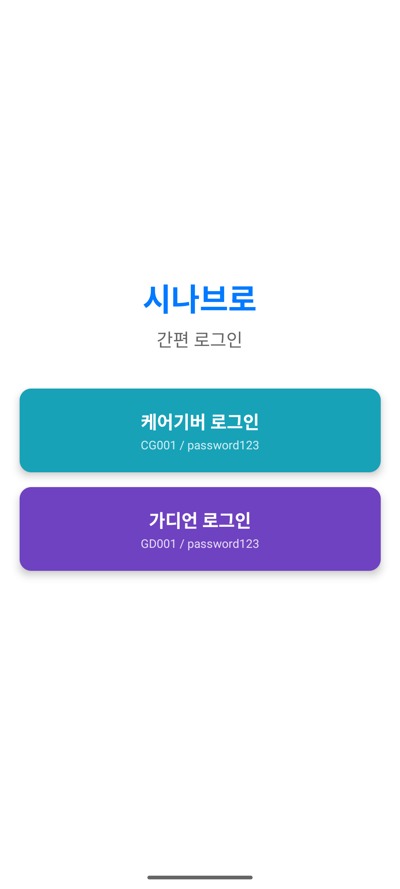
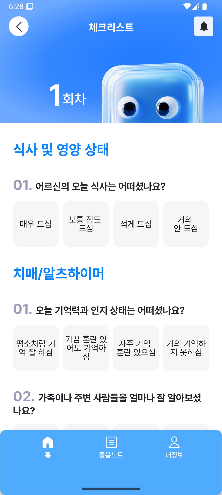
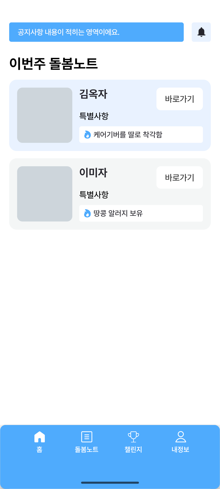
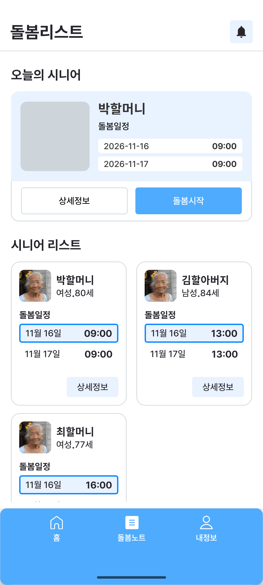
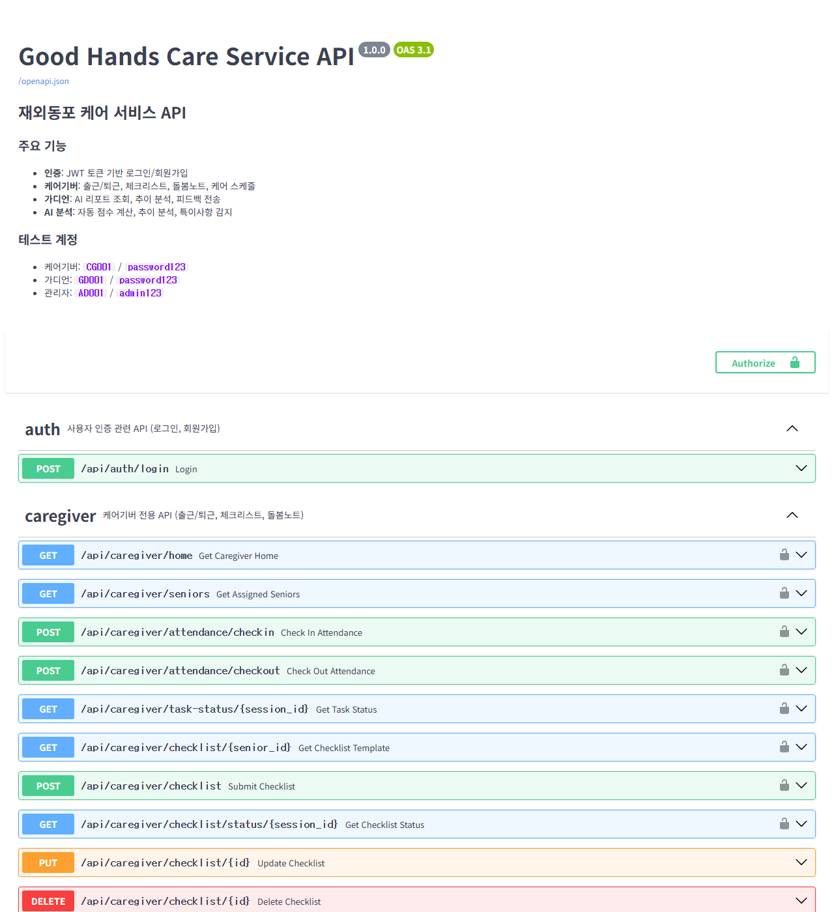
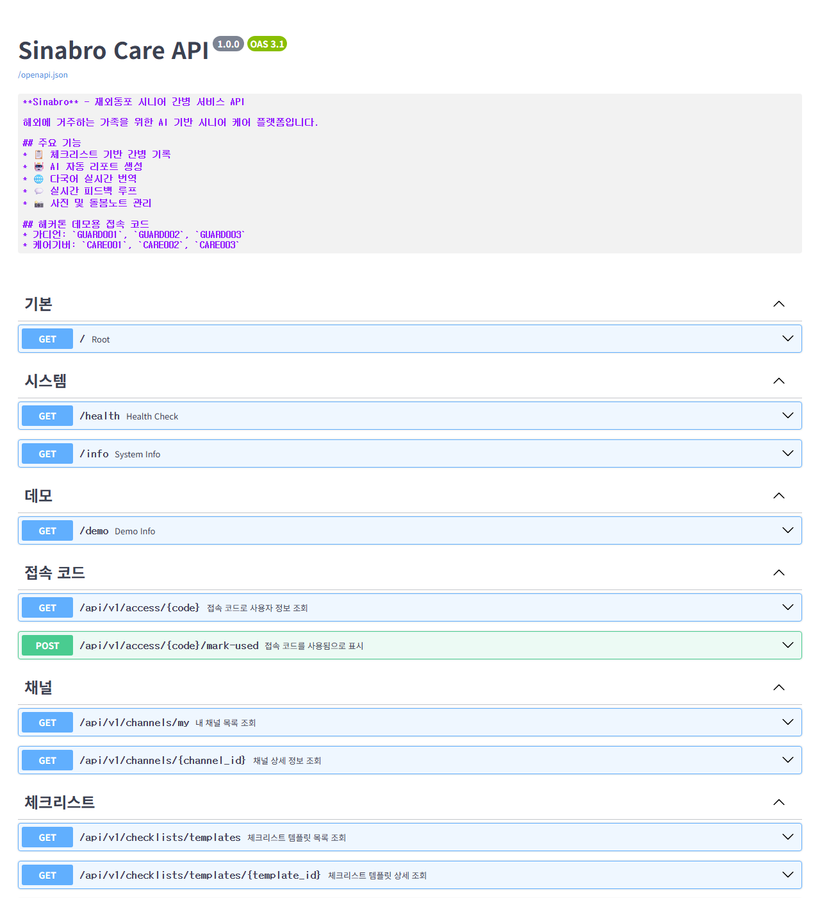

# 시나브로 (Sinabro) — 재외동포 시니어 케어 플랫폼

> **"시나브로"** — 모르는 사이에 조금씩, 천천히. 해외에 사는 자녀가 한국에 계신 부모님의 돌봄 상황을 매일 조금씩 확인할 수 있도록 돕는 서비스입니다.

해외에 거주하는 재외동포 자녀(**가디언**)를 대신해 한국의 **케어기버**가 어르신(**시니어**)을 방문해 돌보고,
그 기록(출근, 체크리스트, 돌봄노트)을 AI가 분석해 가디언에게 전달하는 통합 케어 플랫폼입니다.

<p align="center">
  
  
  
  
</p>

## 사용자와 핵심 흐름

| 사용자 | 하는 일 |
| --- | --- |
| **케어기버** | 오늘의 돌봄 일정 확인 → 돌봄 시작(출근 체크) → 영양·치매·우울 등 카테고리별 체크리스트 작성 → 돌봄노트 작성 |
| **가디언** (재외동포 자녀) | 이번 주 돌봄노트·특이사항 확인, 시니어별 돌봄 기록 열람, 요청사항 남기기, 챌린지 |
| **관리자** | 사용자·시니어 관리, 카테고리별 위험도 대시보드 |
| **AI (n8n 워크플로우)** | 체크리스트 점수 계산, 주간 추이 분석, 가디언용 리포트·코멘트 생성 |

## 저장소 구성

세 개의 저장소를 하나로 합친 모노레포입니다.

```
sinabro-care-platform/
├── frontend/   React Native 앱 (Android/iOS) — 케어기버·가디언 화면
├── backend/    Good Hands API (FastAPI + MariaDB) — 앱이 실제로 붙는 메인 서버
├── api/        Sinabro Care API (FastAPI + PostgreSQL) — 접속 코드·채널·체크리스트 템플릿 API
└── docs/       화면 캡처
```

| 디렉터리 | 기술 스택 | 포트 |
| --- | --- | --- |
| `frontend/` | React Native 0.80, React 19, TypeScript, React Navigation 7, Axios | Metro 8081 |
| `backend/` | Python 3.13, FastAPI 0.116, SQLAlchemy 2.0, MariaDB 11, JWT | 10007 |
| `api/` | Python 3.11, FastAPI 0.104, SQLAlchemy 2.0, PostgreSQL 15 | 8000 |

## 화면

| 로그인 | 케어기버 홈 | 시니어 상세 | 체크리스트 |
| :---: | :---: | :---: | :---: |
|  |  |  |  |

| 돌봄 리스트 | 돌봄 시작(출근) | 가디언 홈 | 가디언 돌봄노트 |
| :---: | :---: | :---: | :---: |
|  |  |  |  |

| Good Hands API 문서 (`backend`) | Sinabro Care API 문서 (`api`) |
| :---: | :---: |
|  |  |

## 로컬에서 실행하기

### 1. 백엔드 (`backend/`, 앱이 사용하는 서버)

MariaDB(또는 MySQL)에 빈 데이터베이스를 하나 만든 뒤:

```bash
cd backend
python -m venv .venv
.venv/Scripts/pip install -r requirements.txt      # macOS/Linux: .venv/bin/pip
cp .env.example .env                                # DATABASE_URL 등 값 수정

python init_db.py                                   # 테이블·뷰 생성 + 시연용 데이터 (여러 번 실행해도 안전)
python -m uvicorn app.main:app --host 0.0.0.0 --port 10007
```

API 문서: http://localhost:10007/docs

루트의 `docker-compose.yml`로 MariaDB와 백엔드를 함께 띄울 수도 있습니다(`docker compose up -d --build` 후
`docker compose exec backend python init_db.py`).

### 2. 프론트엔드 (`frontend/`)

Node 18+, Android Studio(SDK 35, NDK 27.1)가 필요합니다.

```bash
cd frontend
npm ci
npm start            # Metro
npm run android      # 다른 터미널에서 — 에뮬레이터/기기에 설치·실행
```

서버 주소는 `frontend/src/api/config.ts`의 `API_BASE_URL` 한 곳에서 정합니다. 기본값 `http://10.0.2.2:10007/api`는
Android 에뮬레이터에서 개발 PC의 localhost를 가리킵니다. 실제 기기에서는 PC의 IP로 바꾸세요.

> Windows에서 경로가 길면 Android 네이티브 빌드가 260자 제한에 걸립니다. 짧은 경로에 두거나
> `subst N: <frontend 경로>`로 드라이브를 잡은 뒤 빌드하세요.

### 3. Sinabro Care API (`api/`)

PostgreSQL 15에 DB와 사용자를 만든 뒤 `api/database/init/*.sql`을 순서대로 실행합니다.

```bash
cd api
python -m venv .venv
.venv/Scripts/pip install -r requirements.txt
cp .env.example .env                                 # DB_* / SECRET_KEY 수정
cd app && python -m uvicorn main:app --port 8000
```

`api/docker-compose.yml`은 `.env` 값을 읽어 PostgreSQL·Redis·API를 함께 띄웁니다.

### 테스트 계정

| 서비스 | 역할 | 계정 |
| --- | --- | --- |
| backend | 케어기버 | `CG001` / `password123` |
| backend | 가디언 | `GD001` / `password123` |
| backend | 관리자 | `AD001` / `admin123` |
| api | 접속 코드 | 가디언 `GUARD001~003`, 케어기버 `CARE001~003` |

모두 시드 스크립트가 만드는 로컬 개발용 계정입니다.

## 검증 결과

로컬(Windows 11, Android 15 에뮬레이터)에서 확인한 내용입니다. CI는 아직 없습니다.

| 항목 | 결과 |
| --- | --- |
| 프론트 `tsc --noEmit` | 오류 0 |
| 프론트 `eslint .` | 오류 0 (경고 110 — 인라인 스타일 등) |
| 프론트 `jest` | 1/1 통과 |
| 백엔드 GET 엔드포인트 전수 호출 (시드 데이터 기준) | 500 응답 0 |
| 백엔드 `init_db.py` | 빈 DB에서 처음부터 실행해 성공 |
| `api/` 엔드포인트 7개 | 모두 200 |
| 앱 화면 | 케어기버·가디언 전 탭과 상세·체크리스트·요청사항·돌봄 시작 흐름 확인 |

루트·`api/`의 `docker-compose.yml`은 이번에 실행해 보지 못했습니다(검증 PC의 Docker Desktop이 기동되지 않음).

## 통합하면서 고친 것

<details>
<summary>펼쳐 보기</summary>

**보안**
- 운영 DB 접속 정보, 카카오 REST 키, JWT 시크릿, n8n 서버 주소·기본 API 키 등 코드에 박혀 있던 값을 모두 환경 변수로 옮기고 `.env.example`만 남겼습니다. 이력은 새로 시작해 과거 값이 남지 않습니다.
- `N8N_API_KEY`가 비어 있으면 n8n 전용 API를 모두 거절합니다(이전에는 고정 기본 키로 통과).

**백엔드**
- 라우터의 raw SQL이 쓰지만 모델·마이그레이션에 없던 `care_calendar`, `weekly_category_scores`, `category_trend_analysis`, `v_latest_category_status`를 사용처 기준으로 복원(`backend/database/schema_extra.sql`)하고, 빈 DB를 한 번에 준비하는 `init_db.py` 추가
- 모델에 없던 컬럼 복원: `care_sessions.care_calendar_id`, `ai_reports.category_details` 등
- `try` 안에서 던진 404·403이 `except Exception`에 잡혀 500으로 바뀌던 문제 수정(72곳)
- 가디언 API가 `users.id`를 `guardians.id`처럼 비교하던 문제, `CareService` 미임포트, `datetime.timedelta` 오용 수정
- `uploads/` 폴더가 없으면 서버가 뜨지 않던 문제, passlib↔bcrypt 5 비호환(`bcrypt==4.0.1` 고정), 시드 스크립트 오류 수정

**API (`api/`)**
- 패키지 임포트 경로가 섞여 있어 서버가 아예 시작되지 않던 문제 수정
- ORM 관계 이름 불일치, SQLAlchemy 2.0 `text()` 누락, 존재하지 않는 컬럼(`is_active`, `template_items`) 참조, 시간대 비교 오류 수정
- 샘플 접속 코드 만료일을 고정 날짜(2024-12-31) 대신 "생성 시점 + 1년"으로 변경

**프론트엔드**
- 서버 주소를 `config.ts` 한 곳으로 모으고, 카카오 키가 없을 때는 좌표를 표시
- 돌봄 리스트 → 상세정보 버튼 연결, 상세 화면에 시니어 정보가 전달되지 않던 버그 수정
- 어디서도 쓰이지 않으면서 컴파일되지 않던 모듈 정리, Jest 설정(네이티브 모듈 mock) 추가

</details>

## 알려진 한계

- 가디언 화면(홈·돌봄노트·상세)과 "내 정보" 화면은 원래 프로토타입대로 **목업 데이터**를 표시합니다. 백엔드 `/api/guardian/*` API는 동작하지만 화면과 아직 연결되지 않았습니다.
- 지도(출근 위치)는 카카오 REST 키를 `frontend/src/api/config.ts`에 넣어야 표시됩니다.
- AI 리포트 생성은 외부 n8n 워크플로우(`N8N_WEBHOOK_URL`, `N8N_API_KEY`)가 있어야 동작합니다.

## 만든 사람들

- 프론트엔드: [@happy7yong](https://github.com/happy7yong)
- 백엔드·API: [@jhon829](https://github.com/jhon829)
- 통합·정리: [@TIRIOM](https://github.com/TIRIOM)

원본 저장소: `happy7yong/SinabroAppFrontend`, `jhon829/goodhands_backend`, `jhon829/sinabro`
