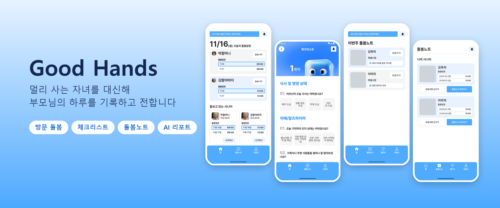
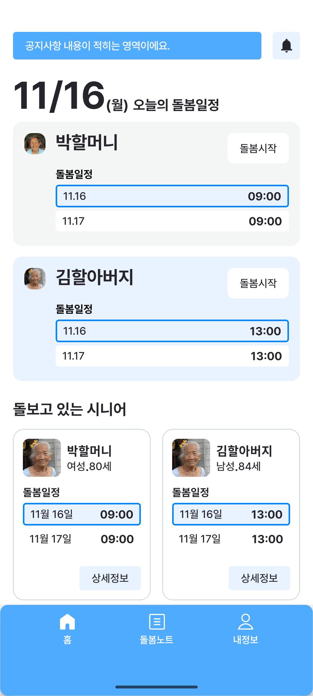
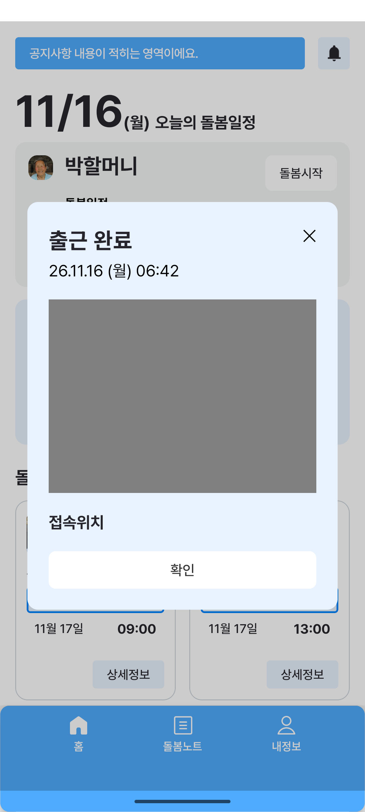
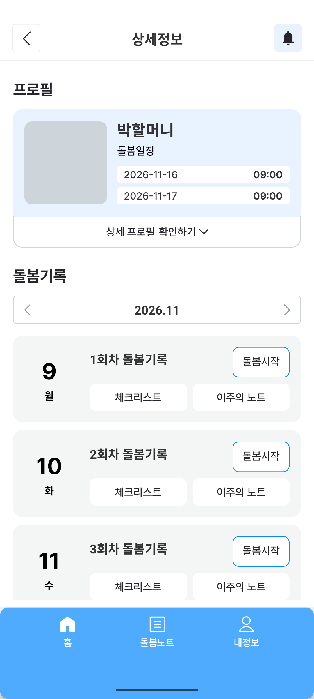
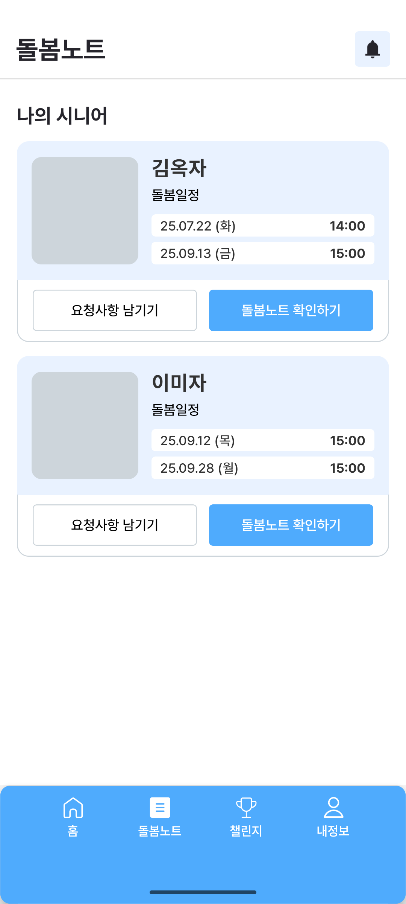
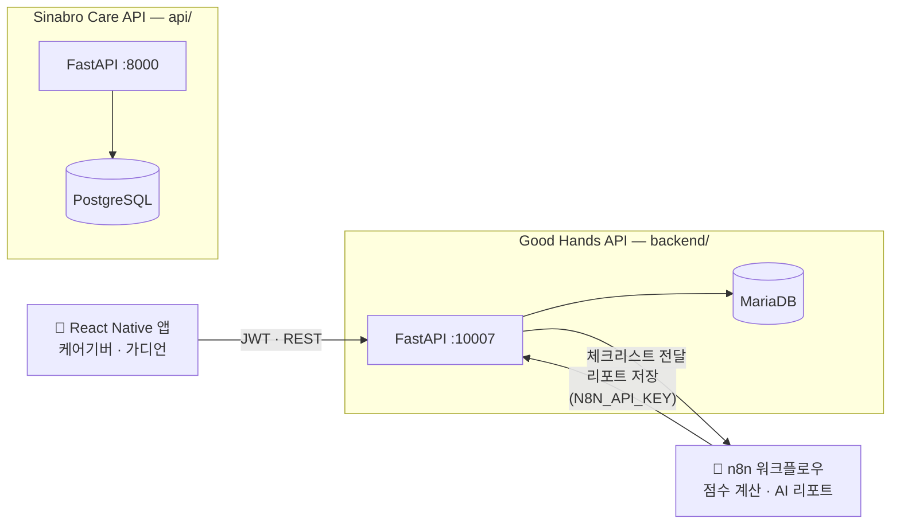

<div align="center">



**Good Hands** · 시니어 방문 돌봄 플랫폼


</div>

> [!NOTE]
> 앱 안의 이름은 **시나브로**입니다. 모르는 사이에 조금씩, 천천히 — 부모님의 하루가 매일 조금씩 자녀에게 닿는다는 뜻입니다.

---

## 📱 프로젝트 소개
> - 해외에 사는 자녀는 한국에 계신 부모님의 하루를 직접 볼 수 없습니다.
> - 방문 돌봄이 있어도 기록은 종이와 전화 속에 흩어지고, 변화는 한참 뒤에야 알게 됩니다.

Good Hands는 **돌보는 사람의 기록과 기다리는 사람의 확인을 한 앱에 모읍니다.** <br>
케어기버는 방문할 때마다 출근을 남기고, 영양·치매·우울 같은 카테고리별 체크리스트를 작성합니다. <br>
그 기록이 쌓이면 AI가 주간 추이를 읽어 가디언이 볼 리포트와 코멘트로 바꿉니다. <br>
가디언은 이번 주 돌봄노트와 특이사항을 확인하고, 케어기버에게 요청사항을 남깁니다.

| 사용자 | 하는 일 |
| --- | --- |
| **케어기버** | 오늘의 돌봄 일정 확인 → 돌봄 시작(출근) → 카테고리별 체크리스트 → 돌봄노트 |
| **가디언** (해외 거주 자녀) | 이번 주 돌봄노트·특이사항 확인, 시니어별 돌봄 기록, 요청사항 남기기, 챌린지 |
| **관리자** | 사용자·시니어 관리, 카테고리별 위험도 대시보드 |

## 📸 흐름

케어기버가 남긴 기록이 가디언에게 닿기까지 여섯 화면을 거칩니다.

| `01` 오늘의 일정 | `02` 돌봄 시작 | `03` 체크리스트 |
| :---: | :---: | :---: |
|  |  |  |
| 오늘 찾아갈 어르신과<br>시간을 한눈에 확인해요 | 도착하면 출근 시각과<br>위치를 남겨요 | 영양·인지·정서를<br>정해진 문항으로 기록해요 |

| `04` 돌봄 기록 | `05` 이번 주 돌봄노트 | `06` 나의 시니어 |
| :---: | :---: | :---: |
|  |  |  |
| 회차마다 남긴 기록이<br>달력처럼 쌓여요 | 가디언은 이번 주<br>특이사항부터 봐요 | 노트를 확인하고<br>요청사항을 남겨요 |

## ⛓️ 구조

앱은 **Good Hands API 하나에만 붙습니다.** <br>
체크리스트 점수 계산과 주간 리포트 생성은 n8n 워크플로우가 맡고, 결과는 다시 같은 API로 들어옵니다. <br>
`api/`의 Sinabro Care API는 접속 코드·채널·체크리스트 템플릿을 다루는 별도 서버입니다.



## 📂 저장소

세 개의 저장소를 하나로 합친 모노레포입니다.

| 경로 | 내용 | 원본 |
| --- | --- | --- |
| [`frontend/`](frontend) | React Native 앱. 케어기버·가디언 화면 | `happy7yong/SinabroAppFrontend` |
| [`backend/`](backend) | Good Hands API. 앱이 실제로 쓰는 메인 서버 | `jhon829/goodhands_backend` |
| [`api/`](api) | Sinabro Care API. 접속 코드·채널·체크리스트 템플릿 | `jhon829/sinabro` |

## 🛠️ 기술 스택

| 영역 | 기술 |
| --- | --- |
| Frontend |      |
| Backend |      |
| Care API |    |
| AI · 자동화 |  |
| 배포 |  |

## 🚀 로컬에서 실행하기

> [!TIP]
> 앱은 `backend/`만 있으면 동작합니다. `api/`는 따로 띄우지 않아도 됩니다.

<details>
<summary><b>1. 백엔드 — Good Hands API</b></summary>

<br>

MariaDB(또는 MySQL)에 빈 데이터베이스를 하나 만든 뒤 실행합니다.

```bash
cd backend
python -m venv .venv
.venv/Scripts/pip install -r requirements.txt      # macOS/Linux: .venv/bin/pip
cp .env.example .env                                # DATABASE_URL 등 값 수정

python init_db.py                                   # 테이블·뷰 + 시연용 데이터 (여러 번 실행해도 안전)
python -m uvicorn app.main:app --host 0.0.0.0 --port 10007
```

API 문서는 http://localhost:10007/docs 에서 볼 수 있습니다. <br>
루트의 `docker-compose.yml`로 MariaDB와 백엔드를 함께 띄울 수도 있습니다
(`docker compose up -d --build` → `docker compose exec backend python init_db.py`).

</details>

<details>
<summary><b>2. 프론트엔드 — React Native 앱</b></summary>

<br>

Node 18+, Android Studio(SDK 35, NDK 27.1)가 필요합니다.

```bash
cd frontend
npm ci
npm start            # Metro
npm run android      # 다른 터미널에서 — 에뮬레이터/기기에 설치·실행
```

서버 주소는 `frontend/src/api/config.ts`의 `API_BASE_URL` 한 곳에서 정합니다. <br>
기본값 `http://10.0.2.2:10007/api`는 Android 에뮬레이터에서 개발 PC의 localhost를 가리킵니다. 실제 기기에서는 PC의 IP로 바꾸세요.

> Windows에서 경로가 길면 Android 네이티브 빌드가 260자 제한에 걸립니다. 짧은 경로에 두거나
> `subst N: <frontend 경로>`로 드라이브를 잡은 뒤 빌드하세요.

</details>

<details>
<summary><b>3. Sinabro Care API</b></summary>

<br>

PostgreSQL 15에 DB와 사용자를 만든 뒤 `api/database/init/*.sql`을 순서대로 실행합니다.

```bash
cd api
python -m venv .venv
.venv/Scripts/pip install -r requirements.txt
cp .env.example .env                                 # DB_* / SECRET_KEY 수정
cd app && python -m uvicorn main:app --port 8000
```

`api/docker-compose.yml`은 `.env` 값을 읽어 PostgreSQL·Redis·API를 함께 띄웁니다.

</details>

<details>
<summary><b>테스트 계정</b></summary>

<br>

| 서비스 | 역할 | 계정 |
| --- | --- | --- |
| backend | 케어기버 | `CG001` / `password123` |
| backend | 가디언 | `GD001` / `password123` |
| backend | 관리자 | `AD001` / `admin123` |
| api | 접속 코드 | 가디언 `GUARD001~003`, 케어기버 `CARE001~003` |

모두 시드 스크립트가 만드는 로컬 개발용 계정입니다. 로그인 화면의 버튼이 케어기버·가디언 계정으로 바로 들어갑니다.

</details>

## ✅ 검증

Windows 11 · Android 15 에뮬레이터에서 로컬로 확인했습니다. CI는 아직 없습니다.

| 항목 | 결과 |
| --- | --- |
| 앱 화면 | 케어기버·가디언 전 탭, 상세·체크리스트·요청사항·돌봄 시작 흐름 |
| 프론트 `tsc` · `eslint` · `jest` | 타입 오류 0 · 린트 오류 0 · 1/1 통과 |
| 백엔드 GET 엔드포인트 전수 호출 | 500 응답 0 |
| 백엔드 `init_db.py` | 빈 DB에서 처음부터 성공 |
| `api/` 엔드포인트 7개 | 모두 200 |

> [!WARNING]
> 루트와 `api/`의 `docker-compose.yml`은 실행해 보지 못했습니다(검증 PC의 Docker Desktop이 기동되지 않음).

<details>
<summary><b>세 저장소를 합치면서 고친 것: 펼쳐서 확인하기</b></summary>

<br>

**보안**
- 운영 DB 접속 정보, 카카오 REST 키, JWT 시크릿, n8n 서버 주소·기본 API 키 등 코드에 박혀 있던 값을 환경 변수로 옮기고 `.env.example`만 남겼습니다. 이력은 새로 시작해 과거 값이 남지 않습니다.
- `N8N_API_KEY`가 비어 있으면 n8n 전용 API를 모두 거절합니다(이전에는 고정 기본 키로 통과).

**백엔드**
- raw SQL이 쓰지만 어디에도 정의되지 않았던 `care_calendar`, `weekly_category_scores`, `category_trend_analysis`, `v_latest_category_status`를 사용처 기준으로 복원(`backend/database/schema_extra.sql`)하고, 빈 DB를 한 번에 준비하는 `init_db.py` 추가
- 모델에 없던 컬럼 복원: `care_sessions.care_calendar_id`, `ai_reports.category_details` 등
- `try` 안에서 던진 404·403이 `except Exception`에 잡혀 500으로 바뀌던 문제 수정(72곳)
- 가디언 API가 `users.id`를 `guardians.id`처럼 비교하던 문제, `CareService` 미임포트, `timedelta` 오용 수정
- `uploads/` 폴더가 없으면 서버가 뜨지 않던 문제, passlib↔bcrypt 5 비호환(`bcrypt==4.0.1` 고정), 시드 스크립트 오류 수정

**Care API (`api/`)**
- 패키지 임포트 경로가 섞여 서버가 아예 시작되지 않던 문제 수정
- ORM 관계 이름 불일치, SQLAlchemy 2.0 `text()` 누락, 없는 컬럼 참조, 시간대 비교 오류 수정
- 샘플 접속 코드 만료일을 고정 날짜 대신 "생성 시점 + 1년"으로 변경

**프론트엔드**
- 서버 주소를 `config.ts` 한 곳으로 모으고, 카카오 키가 없을 때는 좌표를 표시
- 돌봄 리스트 → 상세정보 버튼 연결, 상세 화면에 시니어 정보가 전달되지 않던 버그 수정
- 어디서도 쓰이지 않으면서 컴파일되지 않던 모듈 정리, Jest 설정(네이티브 모듈 mock) 추가

</details>

<details>
<summary><b>알려진 한계</b></summary>

<br>

- 가디언 화면(홈·돌봄노트·상세)과 "내 정보" 화면은 원래 프로토타입대로 **목업 데이터**를 표시합니다. 백엔드 `/api/guardian/*` API는 동작하지만 화면과 아직 연결되지 않았습니다.
- 지도(출근 위치)는 카카오 REST 키를 `frontend/src/api/config.ts`에 넣어야 표시됩니다.
- AI 리포트 생성은 외부 n8n 워크플로우(`N8N_WEBHOOK_URL`, `N8N_API_KEY`)가 있어야 동작합니다.

</details>

## 👥 팀

| [@happy7yong](https://github.com/happy7yong) | [@jhon829](https://github.com/jhon829) | [@TIRIOM](https://github.com/TIRIOM) |
| :---: | :---: | :---: |
|  |  |  |
| Frontend<br>케어기버·가디언 화면 | Backend · API<br>돌봄 기록·AI 리포트 연동 | 통합 · 정리<br>모노레포·로컬 검증 |

---

<div align="center">

**Good Hands** — 멀리서도 **좋은 손**이 곁에 있도록 🤝

</div>
